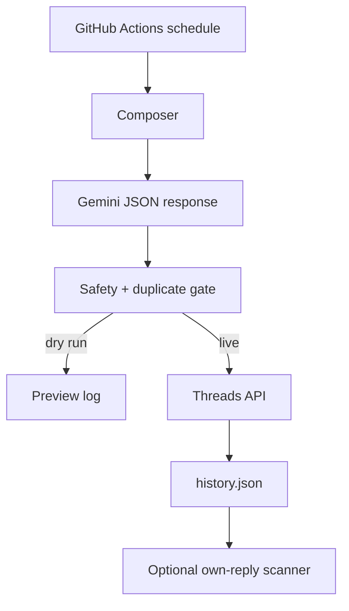

# Thread Automate Life

A small GitHub Actions bot for a **clearly fictional** Vietnamese Gen Z Threads persona. It writes diary-like posts about ordinary student life, not news. The default is deliberately safe: it generates a preview locally in Actions and **does not publish** until you explicitly set `DRY_RUN=false`.

## What this MVP does

- Generates one 80–450-character Vietnamese post through Gemini, with a deterministic, safe fallback if Gemini is unavailable.
- Rejects duplicate-like, link-heavy, urgent, factual/news-like, political, health, money, legal, and engagement-bait content before publishing.
- Uses the official Threads API's two-step text-post flow: create a container, then publish it.
- Retains the last 200 actual posts in `data/history.json` to avoid repeats.
- Has an optional reply scan. It only reads replies under this account's own recorded posts, skips sensitive comments, replies at most 3 times/day, and is disabled by default.
- Runs post generation at **19:15 Vietnam time on Tuesday, Thursday, Sunday**. The reply scan is scheduled daily at 19:45 but is inert until `ENABLE_REPLIES=true`.

It intentionally does **not** scrape arbitrary people's content, impersonate a real student, claim trends are facts, or autonomously argue in political/medical/legal/financial discussions. Put a clear disclosure such as `Nhân vật hư cấu · bài viết có hỗ trợ AI` in the account bio.

## Quick verification, no credentials needed

Run this locally or from **Actions → Threads life bot → Run workflow** with `live=false`:

```bash
python -m unittest -v
python thread_life_bot.py --mode post
```

The second command writes `data/last_run.json` and prints the post it would publish. It never calls Threads while `DRY_RUN=true`.

## Required GitHub configuration

Open **Settings → Secrets and variables → Actions** in this repository.

### Secrets

| Secret | Source | Required for |
|---|---|---|
| `GEMINI_API_KEY` | Google AI Studio API key | Gemini generation. The safe fallback still works without it. |
| `THREADS_ACCESS_TOKEN` | OAuth flow of your Meta Threads app | Live posting and replies |

### Variables

| Variable | Safe initial value | Meaning |
|---|---:|---|
| `DRY_RUN` | `true` | Keep this true while verifying. Set `false` only after a successful manual live test. |
| `GEMINI_MODEL` | `gemini-3.5-flash-lite` | Model identifier. If Google AI Studio shows a different currently available Flash-Lite ID, use that exact ID. |
| `ENABLE_REPLIES` | `false` | Enables tightly limited replies to replies on your own posts only. |
| `REPLY_DAILY_CAP` | `3` | Hard-capped to 5 in code. |
| `TOPIC_SEED` | `campus life, late homework...` | Everyday topics the persona may draw from. |
| `TREND_HINT` | empty | Optional **manually curated**, non-factual cultural mood. It takes priority over the feed. Example: `cuối kỳ, ảnh tốt nghiệp`. Do not paste headlines. |
| `ENABLE_TREND_FEED` | `false` | When `true`, reads Google Trends Vietnam's public RSS as a *signal* only. It does not turn a trend into a claimed fact or headline. |
| `TREND_RSS_URL` | Google Trends Vietnam RSS | Override only with a source you have permission to fetch and use. |

## Meta Threads setup, including finding an old app

1. Sign in to [Meta for Developers](https://developers.facebook.com/apps/) with the Facebook/Instagram identity connected to the Threads account.
2. Check **My Apps**. For each likely app, open **Use cases** and look for **Access the Threads API**. If you find one, inspect its Threads settings, valid OAuth redirect URI, app mode, roles, and existing access token in the Access Token Debugger. Do not reuse a token whose scopes or expiry you cannot verify.
3. If no suitable app exists, select **Create App**, choose the **Threads** use case, then add/configure the Threads API product. Give it an HTTPS redirect URI that you control. For an initial one-account test, add your Threads account as an app role/tester if the app remains in development mode.
4. Complete Threads OAuth with the scopes `threads_basic` and `threads_content_publish`. Add `threads_read_replies` only when you need to list replies, and `threads_manage_replies` only when you enable the optional responder. Exchange/store the resulting user token securely as `THREADS_ACCESS_TOKEN`; never commit it.
5. Use Meta's Token Debugger to confirm the token is for the intended Threads profile, has the requested scopes, and is not expired. Follow Meta's current long-lived-token procedure and calendar a refresh before expiry.
6. In GitHub, keep `DRY_RUN=true`, run the workflow once, inspect its preview. Then use **Run workflow**, select `post`, set `live=true`, and confirm one test post appears in your own account. Only then set repository variable `DRY_RUN=false`.

Meta's exact review requirements can change. Before switching an app to live, read the current Threads API documentation and request only the permissions actually used. Development-mode apps are appropriate for the account added as a tester; a public, multi-user integration generally requires App Review for the requested permissions.

## Threads API capability boundary

| Function | MVP support | Scope to request | Guardrail |
|---|---|---|---|
| Publish text from this profile | Yes | `threads_basic`, `threads_content_publish` | Two-step container/publish call; one scheduled post at a time. |
| Read replies to the profile's recorded posts | Optional | `threads_read_replies` | Only own posts, newest 10 recorded posts. |
| Reply to a reply on an own post | Optional | `threads_manage_replies` plus publishing scopes | Disabled by default; maximum 3/day; skips sensitive or adversarial discussion. |
| Browse the network and reply to strangers | No | Not implemented | Avoids unsolicited/spammy behavior. |
| Automated debate or factual/news commentary | No | N/A | Intentionally excluded to avoid misinformation and escalation. |

## Architecture



## Official references

- [Meta Threads API collection and setup](https://www.postman.com/meta/threads/collection/dht3nzz/threads-api)
- [Meta Threads API changelog](https://developers.facebook.com/docs/threads/changelog)
- [Gemini API `generateContent`](https://ai.google.dev/api/generate-content)
- [Gemini model catalog](https://ai.google.dev/gemini-api/docs/models)
- [GitHub Actions schedule syntax](https://docs.github.com/actions/reference/workflows-and-actions/workflow-syntax)

## Before public launch

- Use a separate fictional account, a disclosure in its bio, and a recognizable profile name/avatar.
- Read and follow the current Meta Platform Terms and Threads API policies. Do not use it to simulate a real person or conceal automated activity.
- Start with `ENABLE_REPLIES=false` for at least a week. Review outputs and error logs before enabling it.
- Keep `ENABLE_TREND_FEED=false` during the first week. A trend is only a cultural signal, not a verified fact. This MVP deliberately treats lifestyle content as creative writing, not information.
